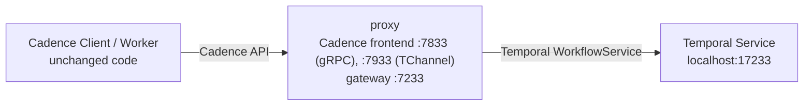

# Cadence Workers on Temporal

This example runs the proxy's Cadence frontend in front of a local Temporal dev server, so a Cadence application runs on
Temporal with nothing changed but the address it dials. See [Cadence compatibility](../../README.md#cadence-compatibility)
for what is translated and what is not.



## Run it

Start a Temporal dev server on port 17233, registering Cadence's stock custom search attributes, which a Temporal
Namespace does not have until you add them:

```bash
temporal server start-dev --port 17233 \
  --search-attribute CustomKeywordField=Keyword \
  --search-attribute CustomStringField=Text \
  --search-attribute CustomIntField=Int \
  --search-attribute CustomDoubleField=Double \
  --search-attribute CustomBoolField=Bool \
  --search-attribute CustomDatetimeField=Datetime
```

Start the proxy from the repository root:

```bash
go run ./cmd/proxy serve --config examples/cadence/config.yaml
```

Point your Cadence application at `127.0.0.1:7833` (gRPC) or `127.0.0.1:7933` (TChannel) where it used to name its
Cadence frontend, and run it against Domain `default`, or register a Domain through the proxy as you would on Cadence.
Its Workflows show up in the Temporal Web UI at <http://localhost:8233> and in `temporal workflow list`.

The [end-to-end suite](../../e2e/cadence) is a complete Cadence application run exactly this way: its harness dials the
frontend with the Cadence Go SDK's own YARPC transports, over gRPC and over TChannel.
